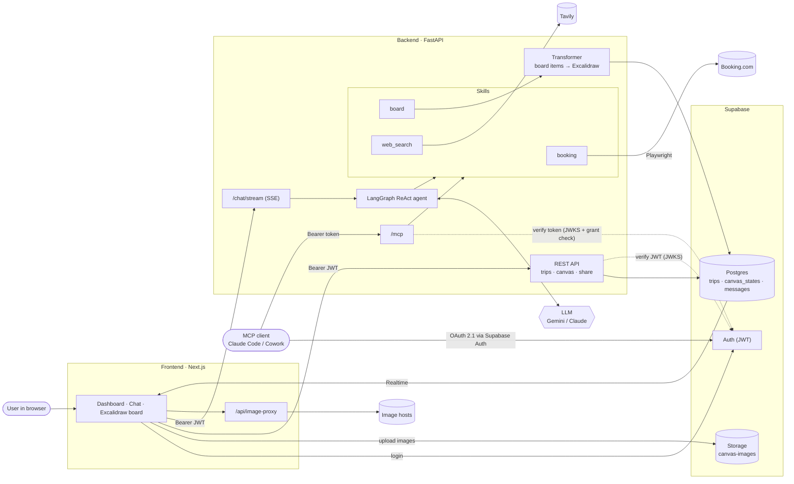

# Trava

> **AI travel planning on a visual canvas.** Chat with an agent, pull real hotel prices from Booking.com, and build your trip on an Excalidraw board — solo or with a group.

🌐 Project landing page: **[trava-travel.com](https://www.trava-travel.com/)**

## What it is

Group travel planning is messy. Shared Google Docs don't scale past three people, every planner tool locks you into its own database, and LLM chat is great for research but forgets everything the moment you close the tab.

Trava is a different shape: a **chat agent + a shared visual canvas**. You tell the agent what you want ("find us a 3-night stay in Lisbon under €150 per night"), it hits Booking.com for real prices and drops cards onto an Excalidraw board. The agent *sees* the board, so it can reason about what's already there — add activities around an existing hotel, replace a pricey option, group by day — without wiping what you've placed.

The agent is swappable (Gemini or Claude) and the tool layer is modular: each capability is a Python package in `backend/skills/` that exports a list of LangChain tools and a prompt. Add a folder, restart, done.

## Status

**Self-hosted only.** There is no hosted version and there won't be one — you'll set up Supabase and your own LLM + search keys. A personal project, shared as-is. Run it locally, or deploy it yourself (see [`docs/deploy.md`](docs/deploy.md)).

## Features

- Chat agent with swappable LLM (Gemini or Claude)
- Real-time Booking.com search via Playwright — real hotels, real prices
- Incremental board edits: the agent appends or removes cards instead of replacing the whole board
- Excalidraw canvas — drag, draw, group, annotate alongside the agent
- Shareable read-only board links
- Supabase for auth, DB, and storage
- Pluggable skill system — add a tool by adding a folder

## Requirements

**This project is self-hosted. You bring your own Supabase, LLM, and search credentials. Expect ~15–30 min to get the external services provisioned on free tiers.**

### Local tooling

- Node.js 20.9+ (required by Next.js 16)
- Python 3.11+
- [Supabase CLI](https://supabase.com/docs/guides/cli) — to apply migrations (and for the local stack the integration tests use)
- macOS / Linux tested; Windows via WSL should work but is unverified

### External services you must provision yourself

All have free tiers sufficient for local use.

- **Supabase project** — auth, Postgres, storage bucket for canvas images. Walkthrough: [`docs/supabase-setup.md`](docs/supabase-setup.md).
- **One LLM provider** — either `GOOGLE_API_KEY` (Gemini via [AI Studio](https://aistudio.google.com), free tier) **or** `ANTHROPIC_API_KEY` (Claude via [console.anthropic.com](https://console.anthropic.com), paid). Set `LLM_PROVIDER=google|anthropic`.
- **Tavily** — `TAVILY_API_KEY` for web + image search (free tier at [tavily.com](https://tavily.com)).

Pointers and signup links: [`docs/services-setup.md`](docs/services-setup.md).

## Quickstart

```bash
# 1. Clone and configure env
git clone <your-fork-url> trava && cd trava
cp .env.example .env
# Fill in the values — see docs/supabase-setup.md and docs/services-setup.md

# 2. Backend
cd backend
python3 -m venv .venv && source .venv/bin/activate
pip install -r requirements.txt
playwright install chromium
uvicorn main:app --reload            # http://localhost:8000

# 3. Frontend (in a second terminal)
cd frontend
npm install
ln -s ../.env .env.local             # frontend reads NEXT_PUBLIC_* from the same file
npm run dev                          # http://localhost:3000

# 4. Database — apply the migrations once (Supabase CLI, from the repo root)
supabase link --project-ref <your-project-ref>
supabase db push
# Or run the files in supabase/migrations/ in order in the SQL Editor — see docs/supabase-setup.md
```

Open [http://localhost:3000](http://localhost:3000) and sign up.

## Usage walkthrough

Your first trip end-to-end:

1. **Sign up** at [http://localhost:3000](http://localhost:3000). Supabase sends a confirmation email.
2. **Create a trip** from the dashboard — give it a name like "Lisbon weekend."
3. **Ask the agent** in the chat panel: *"Find me a 3-night stay in Lisbon under €150 per night, something boutique."*
4. **Watch it search.** The agent calls `booking_search`, parses results, and drops hotel cards onto the Excalidraw board with real prices and booking links.
5. **Iterate.** Ask for activities: *"Add a food tour on day 2 and a day trip to Sintra on day 3."* The agent appends to the existing board instead of starting over.
6. **Share.** Hit the share button to get a read-only link — the recipient sees the board without needing an account.

## Architecture

```
frontend/   Next.js 16 + React 19 + Tailwind (~35% chat, ~65% Excalidraw)
backend/    FastAPI + LangGraph ReAct agent
backend/skills/   Auto-discovered tool packages (booking, board, web_search)
supabase/         Migrations + local stack config (Supabase CLI)
```

- **Frontend** — dashboard, chat panel, Excalidraw canvas, shareable boards.
- **Backend** — FastAPI routes for trips + SSE chat, LangGraph agent, Supabase client.
- **Skills** — each skill is a Python package that exports a `TOOLS` list and a `PROMPT` string. Auto-discovered at agent startup.



## Adding a skill

Skills are the extensibility hook. Every capability the agent has — searching Booking.com, reading the board, web search — is a skill. Adding one is ~20 lines.

1. Make a new folder under `backend/skills/`, e.g. `backend/skills/weather/`.
2. Create `backend/skills/weather/__init__.py`:

   ```python
   from .tools import get_weather

   TOOLS = [get_weather]
   PROMPT = "You can call get_weather(city) to fetch the forecast. Use it when the user asks about weather."
   ```

3. Create `backend/skills/weather/tools.py`:

   ```python
   from langchain_core.tools import tool

   @tool
   def get_weather(city: str) -> str:
       """Return a forecast summary for the given city."""
       # ... call your weather API ...
       return f"Sunny in {city}, 22°C"
   ```

4. Restart the backend. `backend/skills/__init__.py` auto-discovers the new package and the agent picks up the tool + prompt on next boot.

That's the contract. For a real example, look at `backend/skills/booking/` or `backend/skills/web_search/`.

## Using with Claude Code / MCP

The backend serves a remote MCP server at `/mcp`, so Claude Code, claude.ai, Claude Cowork or any other MCP client can plan trips on your boards. Sign-in is OAuth 2.1 with Supabase Auth: there are no tokens to copy.

1. **One-time Supabase setup:** enable the OAuth 2.1 server, set the authorization path to `/oauth/consent`, allow dynamic client registration, and use an asymmetric JWT signing key. Set `PUBLIC_BASE_URL` on the backend to its public URL. Details: [OAuth for agents](docs/deploy.md#oauth-for-agents).
2. **Connect Claude Code:**

   ```bash
   claude mcp add --transport http trava <PUBLIC_BASE_URL>/mcp
   ```

   On first use the browser opens: log in to TRAVA, then press **Allow**.
3. **Ask:** *"Create a trip 'Lisbon' and add 3 hotels under €150 for 12-15 May."*
4. **Open the board** in the app. It updates live while the agent works.

**claude.ai / Claude Cowork / ChatGPT** need a public HTTPS URL (e.g. a Railway deploy); `localhost` only works for Claude Code on the same machine. Menu paths as of September 2026:

- **claude.ai / Cowork:** Customize → Connectors → + → Add custom connector, paste `<PUBLIC_BASE_URL>/mcp`, Add, then Connect; log in and press **Allow**.
- **ChatGPT:** Settings → Security and login → turn on Developer mode; then Plugins → +: a name, MCP server URL `<PUBLIC_BASE_URL>/mcp`, Authentication **OAuth**; log in and press **Allow**.

### Tools

| Tool | What it does |
|------|--------------|
| `list_trips` | List your trips |
| `create_trip` | Create a trip with an empty board |
| `board_read` | Show a board's items and their IDs |
| `board_add_items` | Place hotel/activity cards on a board |
| `board_remove_items` | Remove items by ID (at least 4 characters, as shown by `board_read`) |
| `board_clear` | Remove all agent-placed items, keeping your own drawings |
| `booking_search` | Search Booking.com for hotels with real prices |
| `web_search` | Search the web (Tavily) |
| `image_search` | Search for images (Tavily) |

Every board tool checks that the trip is yours.

### Security

A connected app acts as you on your trips. Disconnect it under **Connected apps** (dashboard → `/settings/connections`); this takes effect immediately, because the backend checks the grant on every request. Agent tokens only work on `/mcp`; the rest of the app API rejects them.

### Known limitations

- No rate limiting on agent calls: Booking.com scraping and Tavily usage are on you.
- An upstream Supabase bug ([supabase/auth#2820](https://github.com/supabase/auth/issues/2820)) may break the consent step for some public MCP clients.
- If you sign up in the middle of connecting, you end up on the dashboard. Reconnect from the client afterwards.
- Supabase gives every token the audience `authenticated` (it ignores RFC 8707 `resource`), so an agent's token is a full project token: until it expires it also works directly against Supabase's Data API, limited by row-level security to your own data. Disconnecting stops `/mcp` at once; direct Supabase access ends when the token expires (the project's JWT expiry, 1 hour by default).

## Environment variables

| Variable | Required | Description |
|----------|----------|-------------|
| `SUPABASE_URL` | Yes | Supabase project URL |
| `SUPABASE_SERVICE_KEY` | Yes | Supabase service role key (backend) |
| `NEXT_PUBLIC_SUPABASE_URL` | Yes | Same URL, for the frontend |
| `NEXT_PUBLIC_SUPABASE_ANON_KEY` | Yes | Supabase anon key (frontend) |
| `LLM_PROVIDER` | Yes | `google` or `anthropic` |
| `GOOGLE_API_KEY` | If Gemini | [AI Studio](https://aistudio.google.com) |
| `ANTHROPIC_API_KEY` | If Claude | [console.anthropic.com](https://console.anthropic.com) |
| `TAVILY_API_KEY` | Yes | [tavily.com](https://tavily.com) — web + image search |
| `NEXT_PUBLIC_BACKEND_URL` | Yes | Usually `http://localhost:8000` in dev |
| `PUBLIC_BASE_URL` | For MCP | Backend's public URL as given to MCP clients; defaults to `http://localhost:8000` |

See `.env.example` for the full template. For deployments, the backend also reads `ALLOWED_ORIGINS` (CORS) — see [`docs/deploy.md`](docs/deploy.md).

## Project structure

```
trava/
├── frontend/                   # Next.js app
│   └── src/
│       ├── app/                # Pages (home, dashboard, login, board)
│       ├── components/         # Canvas, chat, auth
│       ├── lib/                # API helpers, hooks, auth (+ Vitest tests)
│       └── types/              # TypeScript types
│
├── backend/                    # FastAPI app
│   ├── main.py                 # Entry point
│   ├── app/
│   │   ├── api/                # Routes (trips, chat)
│   │   ├── agent/              # LangGraph graph + state
│   │   ├── core/               # Config, prompts, templates, auth
│   │   ├── logic/              # Transformer (Excalidraw element generation)
│   │   ├── models/             # Pydantic schemas
│   │   └── services/           # Database, Playwright
│   ├── skills/                 # Skill packages (auto-discovered)
│   │   ├── booking/            # Booking.com search
│   │   ├── board/              # Board read/add/remove/clear
│   │   └── web_search/         # Tavily web + image search
│   └── tests/
│       ├── unit/               # Pytest unit tests
│       └── integration/        # Pytest against a local Supabase stack
│
├── supabase/
│   ├── config.toml             # Local stack config (Supabase CLI)
│   └── migrations/             # SQL migrations (001–010, timestamped)
│
├── docs/                       # Setup, deployment and plan docs
├── .env.example                # Environment template
└── docker-compose.yml          # Docker Compose setup
```

## Tests

```bash
# Backend (venv active)
cd backend
pip install -r requirements-dev.txt          # pytest lives here, not in requirements.txt
python -m pytest tests/unit -v               # unit tests, no services needed
python -m pytest tests/integration -v        # needs `supabase start` (Docker + Supabase CLI) from the repo root; skips otherwise

# Frontend (Vitest)
cd ../frontend && npm test
```

Unit tests cover URL building and cleaning, auth, share tokens, board tools, budget parsing and models. Integration tests check row-level security, storage rules and the main API flow. No E2E tests.

## Deployment

Docker Compose (local or VPS) and Railway: [`docs/deploy.md`](docs/deploy.md).

## Contributing

This is a personal project shared as-is. It isn't accepting contributions or issues; feel free to fork it.

## Design docs

- [`docs/plan.md`](docs/plan.md) — implementation phases (running log)

## License

[MIT](LICENSE). Copyright © 2026 Pitt Hoeher & Joshua Wehr.

Built on [Excalidraw](https://github.com/excalidraw/excalidraw) (MIT) and other open-source projects — see [`NOTICES.md`](NOTICES.md).
